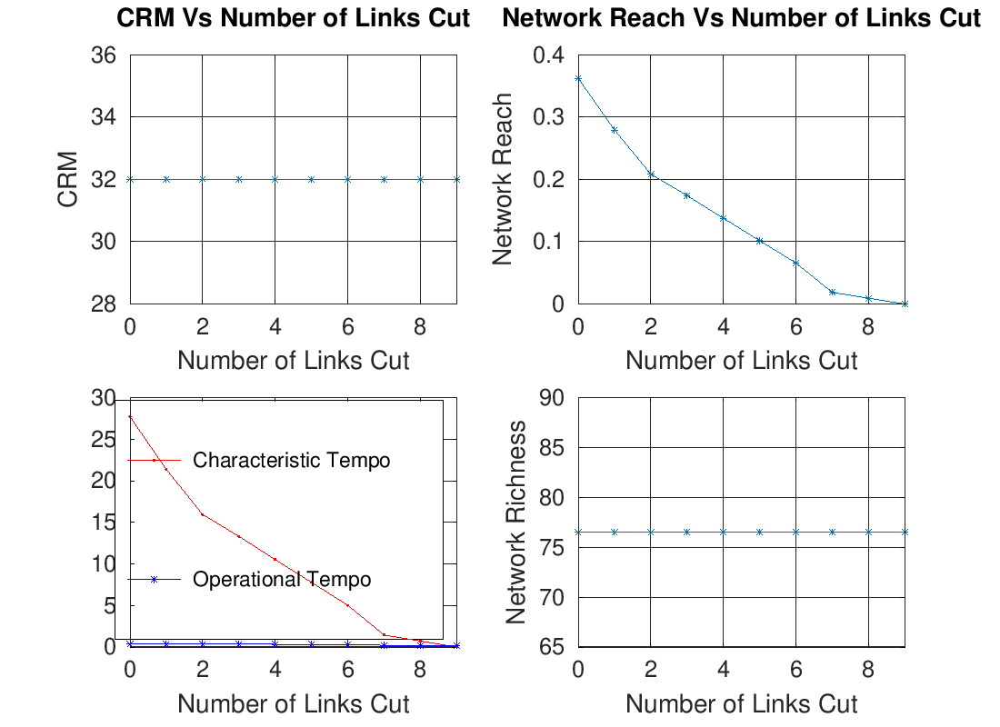

# Tornado-EWNS: Electronic Warfare Network Simulation

Tornado-EWNS is a MATLAB program that models a wireless sensor-weapon network and measures how it
degrades under electronic attack. You describe the network (nodes, their capabilities, information
rates and links). The program computes six network-centric performance metrics, then lets you jam
links one at a time, or lower one node's capability step by step, recomputing everything after each
change and plotting the results.

It was written in 2007 (last revised 9 December 2007) and later printed as an appendix to the
author's book *Network Centric Electronic Warfare* (July 2012). The MATLAB code in `src/` is the
2007 code, unchanged except for the file name of the main script (`tornadoEWNS.m`) and the name
in the program banner.



*The reference network with links jammed one at a time (Link12 first), replayed in GNU Octave.*

## What it models

The scenario is an inhomogeneous missile-attack and damage-assessment network. The reference
network in `examples/` has four nodes linked by nine unidirectional links: a Global Hawk (capability 0.8), a
Predator (0.5), a ship (1.0) and a Tomahawk (0.3), set against a ground weapon system.

For a network of *n* nodes the program computes:

| Metric | How the program computes it |
|---|---|
| Reference connectivity measure (CRM) | A normalising constant that depends only on *n* (32 for four nodes) |
| Network reach | Finds every loop-free route between every ordered pair of nodes. For each route it adds (source capability × flow parameter ÷ number of hops), then divides the total by the CRM |
| Network reach with rerouting | The same sum with every node's capability set to 1 |
| Network richness | (1/*n*) Σ λᵢ ln(λᵢ / λᵢ,min), from each node's information rate and minimum information rate |
| Characteristic tempo | Network reach × network richness |
| Operational (OODA) tempo | C2 / (1 + (1/n₁ + 1/n₂)·C2 + 3·C2 / characteristic tempo), from the C2 decision-making rate and action tempos n₁ and n₂ |

After the first results, a menu offers three options:

1. **Varying capability on a node.** Enter new capability values for one node; the metrics are recomputed each time.
2. **Link jamming.** Cut unidirectional links one at a time; the metrics are recomputed after each cut.
   Cuts are cumulative, and the program will not cut the last remaining link.
3. **Exit.**

Options 1 and 2 can end with a 2 × 2 plot of CRM, network reach, characteristic and operational
tempo, and network richness against the number of links cut or the node's capability.

## Running it

### MATLAB

Put the files of `src/` on the MATLAB path (or `cd src`) and run:

```matlab
tornadoEWNS
```

The program prompts for each value in turn. The files in `examples/` list the exact values typed in
each of the original 2007 runs, one per line, in prompt order.

### GNU Octave

The 2007 code runs unchanged in GNU Octave (checked with Octave 9.4.0 on Debian 13). To use it
interactively, start Octave in `src/` and run the script at the Octave prompt, so the plot window
stays open when the program finishes:

```
cd src
octave
>> tornadoEWNS
```

To replay one of the saved runs without typing, feed an example file on standard input.
`run-example.sh` does this headlessly and can save the plot as a PNG:

```bash
./run-example.sh examples/reference-network.txt                  # results only
./run-example.sh examples/jam-first-link12.txt jamming-plot.png  # results and the 2 x 2 plot
```

The script needs `octave-cli` and `gnuplot` (Debian/Ubuntu: `sudo apt install octave gnuplot-nox`).
It does not change the program: it only selects Octave's gnuplot back end with hidden figures, runs
`tornadoEWNS`, and prints the figure to a file at the end.

| Example file | Run |
|---|---|
| `examples/reference-network.txt` | The reference network, no jamming |
| `examples/jam-first-link12.txt` … `jam-first-link43.txt` | Nine jamming runs, each starting with a different link |
| `examples/capability-node1.txt` | Global Hawk capability reduced from 0.8 to 0 in steps of 0.1 |

## Verification

The console output of eleven complete runs made with MATLAB in 2007 was kept. All eleven were
replayed through the 2007 code in GNU Octave 9.4.0, using the exact inputs typed in 2007, and
every printed result was compared with the 2007 output (`examples/expected/`):

| Run | Result boxes | Values compared | Mismatches |
|---|---|---|---|
| Reference network | 1 | 6 | 0 |
| Jamming runs (nine cut orders) | 9 each | 486 | 0 |
| Node 1 capability 0.8 → 0 | 9 | 54 | 0 |
| **Total** | **91** | **546** | **0** |

All 546 values match to the six decimals the program prints. For example, the reference network:

| Metric | MATLAB, 2007 | Octave replay |
|---|---|---|
| Reference connectivity measure | 32 | 32 |
| Network reach | 0.361979 | 0.361979 |
| Network reach with rerouting | 0.567708 | 0.567708 |
| Network richness | 76.511017 | 76.511017 |
| Characteristic tempo | 27.695394 | 27.695394 |
| Operational tempo | 0.349856 | 0.349856 |

The step-by-step tables for every run are in [`docs/verification.md`](docs/verification.md). The
replayed plots have the same shape as the 2007 MATLAB plots
([capability run](docs/capability-plot.png)). To repeat the check:

```bash
python3 tools/verify.py
```

It replays each run in `examples/` and compares every printed value with `examples/expected/`.

## Notes on the 2007 code

- No source changes were needed to run in Octave. Apart from the main script's file name
  (and the matching header comments) and the name in the program banner, `src/` is byte-for-byte
  the 2007 code.
- The header of `tornadoEWNS.m` lists the helper files it needs; all eight are in `src/`.
- When only one link is left and another cut is requested, the program records a final "no links"
  point (reach and characteristic tempo of zero) for the plot. That is why the jamming plots run to
  nine links cut although the transcripts show eight cuts.

## Repository layout

```
src/                  2007 MATLAB sources (main script tornadoEWNS.m + 8 functions)
examples/             typed inputs for each saved run
examples/expected/    results printed by the 2007 MATLAB runs
docs/verification.md  2007 output vs replay, every value
docs/*.png            plots from the Octave replays
run-example.sh        headless Octave runner
tools/                verification scripts (Python 3)
```

## Licence

MIT, see [LICENSE](LICENSE).
